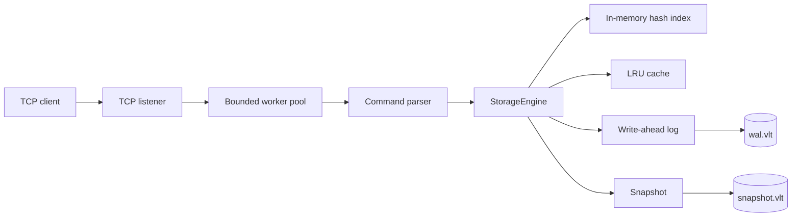

# VoltStore

**A single-node C++20 key-value storage engine**

**Author:** Stephen Chen · **License:** MIT

VoltStore is a Linux-based C++20 key-value storage engine built around an in-memory hash index, a binary write-ahead log (WAL), CRC32-validated snapshots, key expiration, and a TCP command interface. Its design emphasizes ordered persistence, structured restart recovery, bounded request concurrency, and explicit storage invariants.

## Core components

| Component | Implementation | Responsibility |
| --- | --- | --- |
| Storage engine | [`src/storage_engine.cpp`](src/storage_engine.cpp) | Key/value operations, expiration, prefix scans, and synchronization |
| Write-ahead log | [`src/wal.cpp`](src/wal.cpp) | Record encoding, optional `fsync`, ordered replay, and incomplete-tail repair |
| Snapshot | [`src/snapshot.cpp`](src/snapshot.cpp) | Validated binary checkpoints and atomic replacement |
| LRU cache | [`src/lru_cache.cpp`](src/lru_cache.cpp) | Bounded recency tracking |
| TCP server | [`src/server.cpp`](src/server.cpp) | Connections, bounded worker dispatch, and shutdown |
| Thread pool | [`src/thread_pool.cpp`](src/thread_pool.cpp) | Fixed workers and bounded task queue |
| Protocol | [`src/protocol.cpp`](src/protocol.cpp) | Parsing, validation, and response formatting |
| Integrity checks | [`src/crc32.cpp`](src/crc32.cpp) | CRC32 of stored records |

## Request and persistence flow



Diagram source: [`architecture.mmd`](docs/diagrams/architecture.mmd).

A mutation is appended to the WAL before the in-memory index is updated. With `sync_writes=true` (the default), the WAL is synchronized before a successful mutation returns. On startup, the engine loads and validates the snapshot, replays complete WAL records, and repairs an incomplete final record where possible. A complete record with an invalid checksum triggers an explicit integrity error during startup.

The engine's recovery-required state handles index-publication errors after a WAL append; reopening the engine replays the persisted record. The implementation and recovery behavior are documented in [Architecture](docs/architecture.md), [WAL and restart recovery](docs/wal-recovery.md), and the [Recovery model](docs/recovery-model.md).

## Build and test

Requirements: Linux (validated on x86-64), a C++20 compiler, CMake 3.20+, POSIX threads, and Python 3 for process-level integration tests.

```bash
cmake -S . -B build/Debug -G Ninja \
  -DCMAKE_BUILD_TYPE=Debug \
  -DVOLTSTORE_WARNINGS_AS_ERRORS=ON
cmake --build build/Debug --parallel 2
ctest --test-dir build/Debug --output-on-failure --timeout 120

cmake -S . -B build/Release -G Ninja \
  -DCMAKE_BUILD_TYPE=Release \
  -DVOLTSTORE_WARNINGS_AS_ERRORS=ON
cmake --build build/Release --parallel 2
ctest --test-dir build/Release --output-on-failure --timeout 120
```

AddressSanitizer and UndefinedBehaviorSanitizer build:

```bash
cmake -S . -B build/Asan -G Ninja \
  -DCMAKE_BUILD_TYPE=Debug \
  -DVOLTSTORE_ENABLE_SANITIZERS=ON \
  -DVOLTSTORE_WARNINGS_AS_ERRORS=ON
cmake --build build/Asan --parallel 2
ASAN_OPTIONS=detect_leaks=1 \
  ctest --test-dir build/Asan --output-on-failure --timeout 120
```

The test suite includes storage-engine behavior, concurrent access, TCP integration, process termination/restart recovery, WAL-tail repair, corrupt-record rejection, and selected post-WAL failure injection. See [Verification results](docs/verification-results.md) for the environment and actual run records.

## Verification at a glance

- **Debug CTest:** 3/3 passed.
- **Release CTest:** 3/3 passed.
- **AddressSanitizer / UndefinedBehaviorSanitizer:** 3/3 passed.
- **ThreadSanitizer:** 3/3 passed.
- **Clang Static Analyzer:** 9 implementation translation units analyzed; zero diagnostics.

The environment, commands, and verification scope are recorded in [Verification Results](docs/verification-results.md).

## Run locally

Start the server on loopback:

```bash
./build/Release/voltstore_server \
  --data-dir ./voltstore-data \
  --bind 127.0.0.1 \
  --port 7379 \
  --threads 4
```

In another terminal:

```bash
python3 tools/volt_cli.py --host 127.0.0.1 --port 7379
```

Example commands:

```text
PING
PUT sensor:1 0 22.7C
GET sensor:1
EXISTS sensor:1
SCAN sensor: 20
SNAPSHOT
QUIT
```

The protocol is newline-delimited. Request lines are limited to 64 KiB; values returned by `SCAN` escape tabs, backslashes, and control characters. See the [protocol specification](docs/protocol.md).

## Benchmarks

```bash
./build/Release/voltstore_bench --ops 50000 --threads 4
./build/Release/voltstore_bench --ops 1000 --threads 4 --fsync
```

The default benchmark mode measures writes with per-write `fsync` disabled, and its read phase uses the populated in-memory index. Select `--fsync` to measure synchronized writes. Report results with the workload and environment controls in the [benchmark methodology](docs/benchmark-methodology.md), using equivalent workloads, synchronization settings, and hardware for comparisons.

## Operational model and security

- A persistent `.voltstore.lock` file coordinates exclusive ownership of each data directory.
- The in-memory hash index supports point operations; the WAL and snapshots provide persistence and process-restart recovery.
- The TCP command interface is designed for trusted local operation and binds to IPv4 loopback by default. Deployments that extend access beyond the host should integrate an appropriate network-security layer.
- The storage architecture is single-node and uses one active engine per data directory on a local Linux filesystem. Its concurrency, persistence, and recovery behavior is specified in the architecture and recovery documentation.
- I/O error handling and restart behavior are described in the [recovery model](docs/recovery-model.md).

## Technical documentation

- [Engineering Design FAQ — 36 questions on storage architecture, persistence, concurrency, and recovery](docs/engineering-faq.md)
- [Storage engine API and interface contracts](docs/api-reference.md)
- [Architecture](docs/architecture.md)
- [WAL and restart recovery](docs/wal-recovery.md)
- [Recovery model](docs/recovery-model.md)
- [Verification results](docs/verification-results.md)

## Attribution and license

Copyright (c) 2026 Stephen Chen. Distributed under the MIT License; see [LICENSE](LICENSE).
