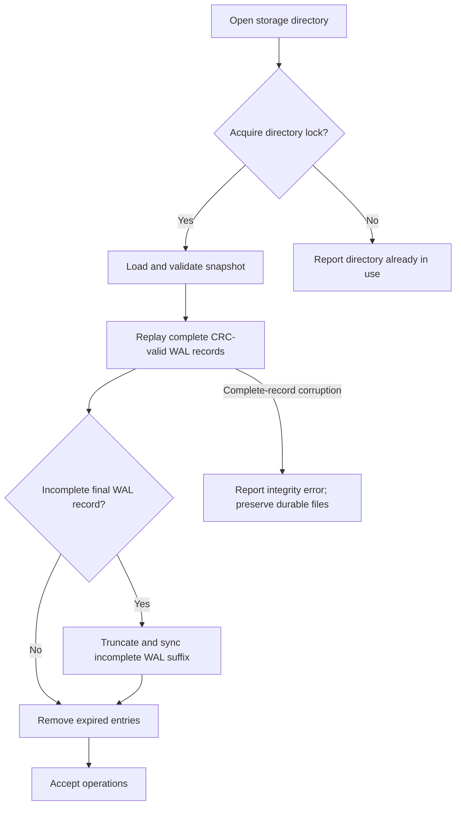

WAL and Restart Recovery
========================

Each PUT or DELETE is encoded as one binary record with an operation code, lengths, absolute TTL timestamp, bytes, and CRC32. The `StorageEngine` serializes mutations. A record is appended before the in-memory map is updated; in the default synchronized mode, `fsync` is invoked before proceeding.

Recovery sequence
-----------------

Diagram source: [`recovery.mmd`](diagrams/recovery.mmd).

Startup order
-------------

1. Load the snapshot, rejecting malformed headers, duplicate keys, checksums, truncated entries and trailing data.
2. Discard entries that have expired under their stored absolute Unix millisecond timestamps.
3. Replay complete WAL records in file order, validating magic, version, operation, lengths and CRC32.
4. If the final record is truncated, truncate the WAL to the byte offset of the last complete record and `fsync` that repair before permitting new appends.
5. Remove entries that expired during replay.

Recovery distinguishes incomplete trailing records from complete records with invalid checksums: incomplete tails are repaired, while complete-record corruption is reported as an integrity error. An unreadable WAL is reported during startup validation, preserving the existing durable state for diagnosis.

Recovery after index-publication errors
---------------------------------------

WAL appends precede the in-memory index change. If index publication raises an exception (for example, due to allocation failure), the persisted operation remains available for replay during the next engine startup. The current engine enters a recovery-required state; closing and reopening it reconstructs the index from the WAL. Fault-injection tests exercise this path for PUT and DELETE. Callers use the recovery report to inspect the replay outcome.

Snapshot ordering
-----------------

A new snapshot is written to a temporary path, synchronized, renamed to the published path, and followed by directory synchronization. Only then is the WAL truncated. If execution stops after the snapshot rename but before WAL truncation, replay may apply some operations already represented in the snapshot; PUT and DELETE are idempotent in this single-key state model.

Validated recovery profile
--------------------------

Process restart and SIGKILL recovery are exercised with real server processes. The storage model uses synchronized WAL writes, validated snapshots, ordered replay, and explicit recovery after I/O errors. When `fsync`, a partial write, or allocation reports an error, startup validation and WAL replay establish the persisted commit state. Callers reopen the engine and inspect recovery results before continuing. The current architecture is designed for one active engine per data directory on a local Linux filesystem.
